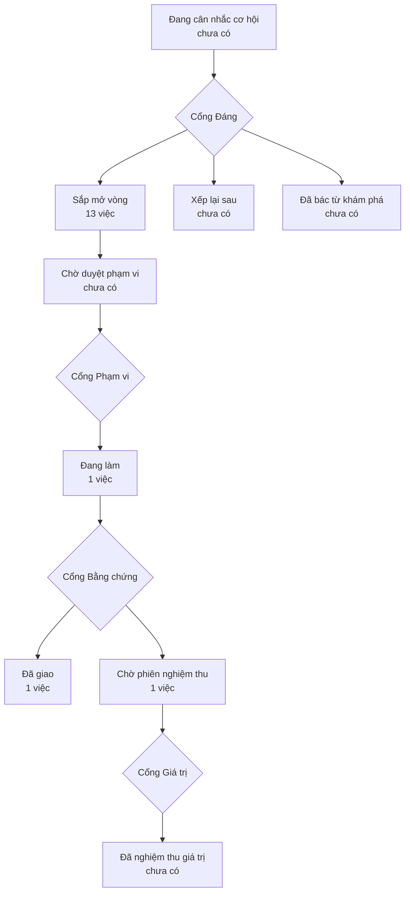

# Bản đồ sản phẩm

> Bản đồ vẽ lại từ hồ sơ của xưởng mỗi lần một người ký một cổng — đừng sửa tay.
> (đọc từ thư mục `_acceptance/` và `.out-of-scope/`)
> Lộ trình: [LO-TRINH.html](LO-TRINH.html)

> **Bốn cổng người** — mỗi cổng là một câu hỏi chỉ người trả lời được:
> **Cổng Đáng** việc này có đáng làm không · **Cổng Phạm vi** bộ tiêu chí
> đã đủ và đúng chưa · **Cổng Bằng chứng** đã làm đúng thứ đã hứa chưa ·
> **Cổng Giá trị** thứ đã giao có ăn thua không.

## Sắp mở vòng

- Đầu chủ mở Bảng hàng và thấy các căn của sàn trên Lưới, đủ trạng thái màn, ở bốn khổ màn hình (`bang-hang-ban-doc`)
- Mỗi màn trong sổ có sẵn bộ bài kiểm trạng thái sinh ra từ sổ, kèm bài phá thử chứng minh bài kiểm đỏ được (`bo-bai-kiem-tu-so-man`)
- Mỗi sàn chỉ đọc và ghi được dữ liệu của mình, mọi truy vấn đi qua một cửa (`cach-ly-moi-san`)
- Vòng dựng màn phải chứng minh giải được và đồng nhất với màn mẫu trước khi trình, rời khỏi thang Trong kho, ReUI, Vẽ tay thì phải nêu căn cứ (`cong-chung-minh-man-mau`)
- Đầu khách mở Đã gửi và thấy các link đã gửi trên cùng Lưới với Bảng hàng (`da-gui-tren-luoi`)
- Nhân viên sàn nhập mã gửi qua email và vào đúng sàn của mình (`dang-nhap-ma-email`)
- Agent tra được danh mục ReUI Pro ngay trong kho theo phiên bản đã ghim, không phụ thuộc kết nối ngoài (`danh-muc-reui`)
- Dựng một sàn mẫu trên Vinhomes Ocean Park 1, 2, 3, căn và liên hệ nối sẵn với nhau, nhãn MAU đủ cho các màn (`du-lieu-mau`)
- Hồ sơ cạnh bảng, lọc rỗng, chờ tải, lỗi, lưu và hoàn tác chỉ có một cách dựng, màn chỉ khai mình cần gì (`hanh-vi-trong-luoi-khung`)
- Đầu chủ bấm một căn và thấy hồ sơ căn cạnh bảng, trên điện thoại thấy thẻ căn (`ho-so-can`)
- Mọi vùng dữ liệu dùng chung Lưới, ô theo kiểu, đầu vùng và đủ trạng thái (`luoi-va-o-theo-kieu`)
- Quản trị sàn mời người vào sàn và gán một trong bốn vai (`moi-nguoi-gan-vai`)
- Mỗi vòng giao diện máy ghi một bản số đo, một lệnh gộp theo tầng, và có mốc đối chứng trước khi dựng nền (`so-do-moi-vong`)

## Đang làm

- Mọi màn và mọi vai được khai cho máy đọc, màn chưa khai hay hợp đồng thiếu vai thì kiểm tra báo đỏ (`khai-vai-va-man`)

## Đã giao — chờ phiên nghiệm thu

- Nhân viên sàn mở ứng dụng ở giao diện sáng hoặc tối, luôn biết mình đang ở màn nào và được báo đúng chỗ khi có sự cố (`khung-va-giao-dien`)

## Đã giao

- `go-hoi-khi-gop`
