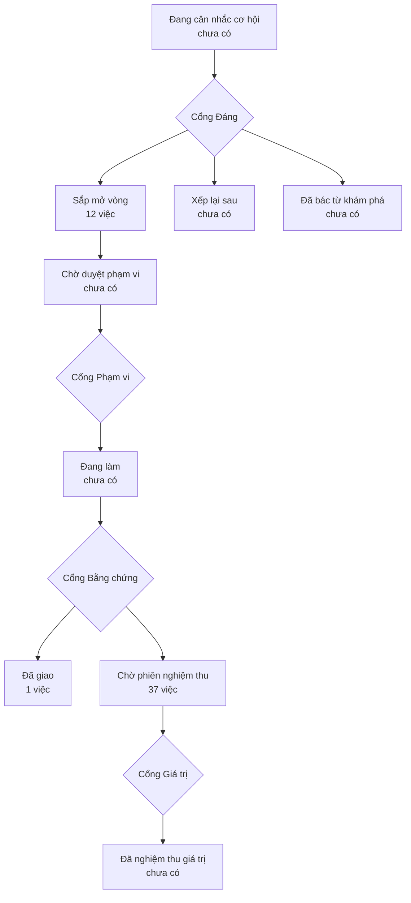

# Bản đồ sản phẩm

> Bản đồ vẽ lại từ hồ sơ của xưởng mỗi lần một người ký một cổng — đừng sửa tay.
> (đọc từ thư mục `_acceptance/` và `.out-of-scope/`)
> Lộ trình: [LO-TRINH.html](LO-TRINH.html)

> **Bốn cổng người** — mỗi cổng là một câu hỏi chỉ người trả lời được:
> **Cổng Đáng** việc này có đáng làm không · **Cổng Phạm vi** bộ tiêu chí
> đã đủ và đúng chưa · **Cổng Bằng chứng** đã làm đúng thứ đã hứa chưa ·
> **Cổng Giá trị** thứ đã giao có ăn thua không.

## Sắp mở vòng

- Đầu chủ và Đầu khách mở Bảng hàng trên điện thoại thấy danh sách thẻ căn và chạm thẻ để mở hồ sơ căn (`bang-hang-the-dien-thoai`)
- Đầu chủ đi Bảng hàng theo địa lý: chọn dự án, phân khu, toà ở cột thứ hai của App Shell và lọc các cột địa lý trên bảng (`bang-hang-theo-dia-ly`)
- Đầu chủ và Đầu khách lọc mọi bảng họ Lưới chỉ bằng cách gõ vào ô lọc dưới tiêu đề cột như ở Sheet; ô «Gõ để tìm» của vùng không còn trên màn nào của họ Lưới — Bảng hàng, Đã gửi, sau này Liên hệ; tìm thì dùng ô ⌘K ở thanh trên của App Shell (hàng 3f) (`bo-o-tim-cua-vung`)
- Cổng chứng minh màn bắt được khối mới mà vòng dựng không kê ra trong hồ sơ (`cong-bat-khoi-khong-ke`)
- Nhân viên sàn đăng nhập bằng mã email trên màn đăng nhập chọn từ ReUI Pro, luồng và luật an toàn giữ nguyên (`dang-nhap-chon-tu-reui`)
- Đầu khách bấm «Hỏi đầu chủ» trên hồ sơ căn để mở bảng chia sẻ của máy với tin soạn sẵn cho người giữ căn, và bấm «Báo sai thông tin căn» để soạn tin nêu trường sai cùng giá trị đúng; người tự bấm gửi (`hoi-dau-chu-bao-sai`)
- Đầu chủ mở hồ sơ căn và thấy lịch sử của căn: tạo lần chào, đổi giá, đổi trạng thái, đổi thông tin, xác nhận với chủ nhà, mỗi việc kèm vai người làm và lúc làm (`lich-su-cua-can`)
- Mỗi sàn có lớp riêng của mình trên lõi chuẩn — nhãn riêng, trường riêng, từ điển giá trị, căn chờ khớp và mẫu nhập — và Bảng hàng hiện trường riêng, đọc nhãn riêng của sàn (`lop-rieng-cua-san`)
- Đầu chủ ghim ngăn chi tiết thành một cột cạnh bảng khi làm lâu trên một căn, bỏ ghim thì ngăn nổi lại (`ngan-chi-tiet-ghim-thanh-cot`)
- Đầu chủ đổi giá và đổi trạng thái ngay trong hồ sơ căn trên điện thoại, theo cùng luật với sửa trên ô của Bảng hàng (`sua-nhanh-tren-dien-thoai`)
- Quản trị sàn xem danh sách người và mời người trên màn Thành viên chọn từ kho và ReUI Pro, quyền và luật mời giữ nguyên (`thanh-vien-chon-tu-reui`)
- Quản trị sàn đặt Thuế phí và thấy Bảng hàng tính theo mức đó (`thue-phi`)

## Đã giao — chờ phiên nghiệm thu

- Nhân viên sàn làm việc trong một App Shell chọn từ ReUI Pro, giữ đủ thanh bên theo vai, băng báo và các trạng thái toàn trang đang có (`app-shell-chon-tu-reui`)
- Đầu chủ mở Bảng hàng và thấy các căn của sàn trên Lưới, đủ trạng thái màn, ở bốn khổ màn hình (`bang-hang-ban-doc`)
- Đầu chủ dùng Bảng hàng bằng tay như Sheet: đi giữa các ô bằng phím mũi tên, bôi một vùng ô rồi chép sang Zalo hay Excel, bấm tiêu đề để sắp xếp, lọc từng cột, nhóm dòng theo toà, ẩn hiện cột (`bang-hang-dung-tay-nhu-sheet`)
- Mọi thao tác đọc và ghi đều được quyết định từ một bảng quyền theo vai, phạm vi và trạng thái (`bang-quyen-theo-vai`)
- Mỗi màn trong sổ có sẵn bộ bài kiểm trạng thái sinh ra từ sổ, kèm bài phá thử chứng minh bài kiểm đỏ được (`bo-bai-kiem-tu-so-man`)
- Bộ kiểm chung sinh từ sổ màn chạy được trên màn cần đăng nhập và không lỡ nhịp khi máy chậm (`bo-kiem-chung-khi-dang-nhap`)
- Người dùng ở vai nào cũng thấy bộ nút thêm, sửa, gỡ đặt cùng một chỗ trên mọi màn và chỉ thấy nút mình được dùng theo bảng quyền (`bo-nut-theo-quyen`)
- Bộ kiểm cách ly bắt cả dạng xem chỉ cấp quyền ghi, sửa hay xoá cho vai của ứng dụng mà không chạy theo quyền người đọc (`cach-ly-dang-xem-chi-ghi`)
- Mỗi sàn chỉ đọc và ghi được dữ liệu của mình, mọi truy vấn đi qua một cửa (`cach-ly-moi-san`)
- Bộ kiểm cách ly giữa các sàn bắt thêm tám kẽ hở đã nêu ở hàng 7 trước khi nối dữ liệu thật (`cach-ly-truoc-du-lieu-that`)
- CI chạy các bài trình duyệt có đăng nhập trên một Postgres riêng của lượt, để bộ kiểm chung đo được màn cần đăng nhập ngay trên CI (`ci-co-postgres`)
- Vòng dựng màn phải chứng minh giải được và đồng nhất với màn mẫu trước khi trình, rời khỏi thang Trong kho, ReUI, Vẽ tay thì phải nêu căn cứ (`cong-chung-minh-man-mau`)
- Đầu khách mở Đã gửi và thấy các link đã gửi trên cùng Lưới với Bảng hàng (`da-gui-tren-luoi`)
- Nhân viên sàn nhập mã gửi qua email và vào đúng sàn của mình (`dang-nhap-ma-email`)
- Danh mục căn dùng chung lưu cùng cách với onehub-invest: có cấp phân khu dưới dự án, tầng lưu theo RESO, toà · trục · căn có khoá riêng, mã căn gốc giữ làm bí danh (`danh-muc-can-nhu-onehub-invest`)
- Agent tra được danh mục ReUI Pro ngay trong kho theo phiên bản đã ghim, không phụ thuộc kết nối ngoài (`danh-muc-reui`)
- Ghim lại danh mục ReUI từ nguồn đã đổi cách ghi tiêu đề mục thì máy dừng và gọi tên nhóm bị mất thay vì lặng lẽ bỏ cả nhóm, và phép chặn mã hay khoá phủ đủ các dạng đã kê (`danh-muc-reui-doc-chac`)
- `du-lieu-mau`
- Hồ sơ cạnh bảng, lọc rỗng, chờ tải, lỗi, lưu và hoàn tác chỉ có một cách dựng, màn chỉ khai mình cần gì (`hanh-vi-trong-luoi-khung`)
- Đầu chủ bấm một căn và thấy hồ sơ căn cạnh bảng, trên điện thoại thấy thẻ căn (`ho-so-can`)
- Đầu chủ mở hồ sơ căn và đọc đủ thông tin của căn và của lần chào (`ho-so-du-thong-tin`)
- `khai-lien-ket-chao-can`
- Mọi màn và mọi vai được khai cho máy đọc, màn chưa khai hay hợp đồng thiếu vai thì kiểm tra báo đỏ (`khai-vai-va-man`)
- Nhân viên sàn mở ứng dụng ở giao diện sáng hoặc tối, luôn biết mình đang ở màn nào và được báo đúng chỗ khi có sự cố (`khung-va-giao-dien`)
- Mỗi màn được kiểm bằng từng vai ở bốn khổ màn hình, vai không được vào thấy đúng Không đủ quyền và không lộ dữ liệu (`kiem-vai-theo-man`)
- Đầu chủ chép đường dẫn một căn gửi đồng nghiệp mở đúng căn và đúng lần chào, và gõ mã căn ở thanh trên để mở thẳng hồ sơ căn trên Bảng hàng (`loi-vao-ho-so`)
- Mọi vùng dữ liệu dùng chung Lưới, ô theo kiểu, đầu vùng và đủ trạng thái (`luoi-va-o-theo-kieu`)
- Đầu chủ lưu cách xem Bảng hàng (lọc, sắp xếp, nhóm, cột đang hiện) thành một mục ở cột thứ hai của App Shell và mở lại đúng cách xem ấy (`luu-goc-nhin-cot-hai`)
- Quản trị sàn mời người vào sàn và gán một trong bốn vai (`moi-nguoi-gan-vai`)
- Lệnh ghi số đo của một vòng không bao giờ lặng lẽ bỏ tầng đã khai: bản số đo cũ đọc không được thì lệnh dừng và nói rõ, không ghi đè (`so-do-ghi-khong-mat-tang`)
- Mỗi vòng giao diện máy ghi một bản số đo, một lệnh gộp theo tầng, và có mốc đối chứng trước khi dựng nền (`so-do-moi-vong`)
- Đầu chủ sửa giá và trạng thái ngay trên ô, thấy lỗi ngay tại ô đó (`sua-tren-o`)
- Vòng dựng màn đi đúng thang kho, kho kết hợp ReUI Pro, tạo tay; thứ mới nhập kho được bày cho chủ kho chọn ở Cổng Phạm vi và có một dòng trong sổ khối (`thang-chon-khoi-vao-cong`)
- Một nhân viên giữ nhiều vai cùng lúc thấy đủ mục điều hướng của mọi vai mình giữ (`thanh-ben-nhieu-vai`)
- Thư mời dẫn người được mời tới đúng trang đăng nhập của sản phẩm, lấy từ cấu hình chứ không từ yêu cầu gửi tới (`thu-moi-dia-chi-tu-cau-hinh`)
- Ứng dụng nối cơ sở dữ liệu bằng một vai đăng nhập không phải chủ bảng, chỉ là thành viên của vai API, để mã trong cửa có đổi vai cũng không về được vai chủ (`ung-dung-noi-bang-vai-khong-chu`)
- Sau khi đăng nhập người dùng không bao giờ bị đưa sang trang ngoài, bấm Đăng xuất mà lỗi thì được báo rõ, và người không còn thuộc sàn nào có lối thoát khỏi màn chọn sàn (`va-dang-nhap`)

## Đã giao

- `go-hoi-khi-gop`
