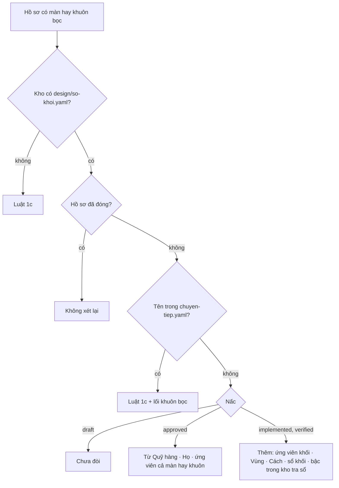

# Thang chọn khối vào cổng — thiết kế

Hàng `1n` của lộ trình (`docs/plan/lo-trinh.json`), ô `_acceptance/thang-chon-khoi-vao-cong/opportunity.md` (chủ kho quyết
build 11/11/2026). Nguồn sự thật: `wiki/decisions/0023-chon-truoc-tao-sau.md`. Dựng trên cổng của hàng 1c
(`_acceptance/cong-chung-minh-man-mau/`, quyết định 0019) và bản gốc bên Quỹ hàng (ADR-0019 «ba lối», bản hiện trạng cổng chọn
khối).

## 1. Bài toán

Quyết định 0023 chốt thang ba bậc — (1) lắp ghép từ kho, (2) kho kết hợp ReUI Pro, (3) tạo tay — và «kho lớn dần»: thứ dùng
lần đầu thì nhập kho, từ đó lần sau là bậc 1. Cổng chứng minh màn hôm nay lách được ở bốn chỗ:

1. Bậc `trong-kho` tra `design/component-registry.json`, mà tệp này tự sinh từ mã. Khối vòng vừa tạo đăng ký vào đó là thành
   «trong kho» ngay trong chính vòng — đúng cách App Shell, đăng nhập, màn Thành viên đi qua.
2. Cổng chỉ tra từng khối nhỏ, không tra cả màn; không đòi bày ứng viên ReUI cho chủ kho chọn.
3. Khối ReUI lấy về được «giữ nguyên hình» ở cấp khối, nên không ai ghi vùng nào lấy, bỏ, thêm, vì sao.
4. Hồ sơ màn không bắt đọc Quỹ hàng, không bắt khai họ của màn — năm hồ sơ màn trích Quỹ hàng 0 lần; màn Thành viên để họ
   rỗng rồi đi lối họ mới.

Hàng này sửa cổng và luật giao diện để bảy điều của lời giao đỏ được, và chuyển tiếp các hồ sơ đang chạy mà không làm đỏ hồ sơ
đã qua Cổng Phạm vi.

## 2. Giữ gì của hàng 1c

Ba lối máy suy (họ mới · màn mẫu mới · theo mẫu), mọi bảng, mọi mã lỗi, mọi ca phá trong `proof-gate.test.ts` giữ nguyên chữ.
Luật mới chỉ **thêm** mục và mã; không đổi nghĩa mã cũ trên hồ sơ cũ. Hồ sơ đã đóng không bị xét lại (như 1c). Lời tiêu chí đã
ký của 1c không đổi.

## 3. Hai lớp luật: cũ và 0023

Luật 0023 bật khi kho có `design/so-khoi.yaml`. Kho chưa có sổ là kho chưa áp 0023: các kho mẫu của bài kiểm hàng 1c không có sổ,
nên mọi bài cũ chạy y nguyên trên luật 1c mà không phải sửa lời. Bài «kho thật» ghim rằng kho thật có sổ — xoá sổ là đỏ.

| Hồ sơ còn mở | Luật áp |
| --- | --- |
| có tên trong `tools/proof_gate/chuyen-tiep.yaml` | luật của 1c, cộng lối khuôn bọc (mục 9) |
| mọi hồ sơ khác | luật của 1c **và** luật 0023 (mục 4–9) |

`chuyen-tiep.yaml` kê đúng các hồ sơ đã qua Cổng Phạm vi lúc hàng này gộp, mỗi dòng một lý do: `app-shell-chon-tu-reui` (1o,
`approved`), `moi-nguoi-gan-vai` (9, `verified`), `va-dang-nhap` (1m, `verified`). Danh sách chỉ được bớt: bài kiểm ghim nó là
tập con của ba tên ấy, nên thêm một tên là sửa bài kiểm — thấy ngay trong diff. Hồ sơ đóng lại thì tên ở đó vô hại. Miễn trọn chứ không miễn từng
phần: miễn chỉ các mục từ `approved` thì 1o vẫn đỏ ở `implemented`, trái lời giao và tin G-1111-20 của giám sát. Lỗ còn lại —
App Shell của 1o nhập kho mà cổng không ép dòng sổ — giám sát nhắc dãy H ghi dòng sổ tay; hàng sau ghi App Shell `trong-kho` mà
sổ chưa có thì đỏ `trong-kho-chua-nhap`, nên lỗ không lọt im.

Hồ sơ Bảng hàng (`bang-hang-ban-doc`, hàng 2) còn `draft`, chưa qua Cổng Phạm vi, nên chịu luật 0023 — đúng phán quyết 11:00Z và
11:20Z của giám sát («áp ngay cho mọi hàng chưa qua Cổng Phạm vi»). Hàng 1p, 9c chưa có hợp đồng nên cũng chịu luật mới.

## 4. Khi nào luật 0023 đòi

| Trạng thái | Đòi thêm |
| --- | --- |
| `draft` | chưa đòi |
| `approved` (đã qua Cổng Phạm vi) | mỗi màn: `### Từ Quỹ hàng`, `### Họ`; màn lối họ mới hay màn mẫu mới: nhóm ứng viên `màn` trong `### Ứng viên ReUI`; khuôn bọc: `### Từ Quỹ hàng` và nhóm ứng viên của khuôn |
| `implemented`, `verified` | thêm: mỗi khối `reui` hay `ve-tay` có nhóm ứng viên, khối `reui` có `### Vùng` và cột `Cách`; mọi khối nhập kho có dòng sổ khối |

Lý do chia: thứ chủ kho chọn ở Cổng Phạm vi (Quỹ hàng, họ, ứng viên cả màn) phải có lúc duyệt; bảng khối chỉ trọn khi dựng xong
(như 1c).

## 5. Bậc `trong-kho` tra sổ khối (điều 1, điều 4)

Tệp mới `design/so-khoi.yaml` (hàng này tạo, rỗng: theo 0023 chưa thứ gì «thuộc kho» đúng nghĩa — App Shell, đăng nhập, màn
Thành viên, hộp thoại biểu mẫu chưa từng được bày; khuôn Lưới xếp ở hàng 2). Mỗi dòng:

| Khoá | Nghĩa | Máy kiểm |
| --- | --- | --- |
| `ten` | tên khuôn của kho | không trùng |
| `tep` | tệp mã của khuôn | có thật |
| `nguon` | tên khối ReUI, hay `tao-tay` | tên có trong `design/reui-catalog.json` |
| `nhu_cau` | khoá nhu cầu (chữ thường, gạch nối) | **không hai dòng cùng khoá** |
| `mo_ta` | một câu nhu cầu bằng lời | không rỗng |
| `ho_so` | hồ sơ đã nhập nó | `_acceptance/<ho_so>/contract.md` có thật; bảng Khối của hồ sơ ấy có dòng chứng từ (khối nguồn bậc `reui`, hay chính `ten` bậc `ve-tay`) |
| `duyet` | ngày chủ kho duyệt | `YYYY-MM-DD`; bằng ngày `approved_at` của hồ sơ ấy |

Bậc `trong-kho` (hồ sơ luật 0023) hợp lệ khi tên là:

- một thành phần của nhà cung cấp — dòng sổ thành phần có tệp dưới `src/components/ui/` hay `src/components/reui/` (tầng một
  của 0023: giữ nguyên như nhà cung cấp giao); hoặc
- một dòng sổ khối mà `ho_so` **khác** hồ sơ đang xét.

Không thì đỏ: `trong-kho-tu-vong` (sổ ghi chính hồ sơ này nhập), `trong-kho-chua-nhap` (có trong sổ thành phần, dưới
`candidate/` hay `templates/`, mà chưa có dòng sổ khối), `khoi-khong-co` (không có ở đâu). Ngược lại, mỗi khối `reui` hay
`ve-tay` của hồ sơ đang mở phải có dòng sổ `ho_so` = hồ sơ ấy từ `implemented` (`nhap-kho-thieu-so`) — nhập kho là một dòng
sổ (0023 điều 7).

Khoá nhu cầu là thước máy cho «một nhu cầu, một lời giải»: hai dòng cùng khoá thì đỏ (`so-trung-nhu-cau`). Hai khoá khác nhau
mà cùng một nhu cầu thật thì máy không thấy — **người soi** ở Cổng Phạm vi.

## 6. Ứng viên ReUI kèm ảnh (điều 2)

`### Ứng viên ReUI` — `| Cho | Ứng viên | Ảnh | Chọn |`. `Cho` là `màn`, tên khuôn bọc, hay tên khối ở bảng Khối. Mỗi nhóm:
2–3 dòng; ứng viên là tên có trong danh mục ReUI; ảnh là PNG trong hồ sơ, không hai ảnh trùng byte; chọn nhiều nhất một. Khối
bậc `reui` phải là ứng viên được chọn của nhóm nó; khối `ve-tay` thì không ứng viên nào được chọn (tạo tay là chủ kho chọn bỏ cả
ba). Mã: `thieu-ung-vien`, `ung-vien-it`, `ung-vien-nhieu`, `ung-vien-khong-co`, `anh-khong-co`, `anh-khong-phai-png`,
`ung-vien-trung-anh`, `chon-qua-mot`, `reui-khong-duoc-chon`, `ve-tay-ma-chon`.

Ảnh có đúng là ảnh của khối ReUI mang tên ấy không, máy không đo — **người soi**. Máy chỉ chặn thiếu ảnh, ảnh giả (không PNG)
và một ảnh dùng cho hai ứng viên.

## 7. Vùng lấy, bỏ, thêm (điều 3)

`### Vùng` — `| Khối | Vùng | Xử lý | Lý do |`, xử lý ∈ `lấy` · `bỏ` · `thêm`, lý do không rỗng. Mỗi khối `reui` có ít nhất một
dòng. Bảng Khối thêm cột `Cách` (chỉ đọc ở hồ sơ luật 0023; hồ sơ cũ không có cột vẫn qua): `chọn khối` hay `ghép từ thành
phần`, bắt buộc cho khối `reui`. Số `bỏ` lớn hơn nửa (`lấy` + `bỏ`) mà ghi `chọn khối` thì đỏ `cat-qua-nua`. Mã khác:
`thieu-vung`, `vung-xu-ly-la`, `vung-thieu-ly-do`, `thieu-cach`, `cach-la`.

Danh sách vùng có đủ vùng thật của khối không, và nhu cầu con có dùng lời giải của kho không (báo lỗi, thông báo, trống) — danh
mục ReUI không kê vùng nên máy không đo: **người soi**.

## 8. Từ Quỹ hàng và Họ (điều 5, điều 6)

`### Từ Quỹ hàng` — một dòng `| Trang | Khối Quỹ hàng đã chọn | Giữ | Bỏ | Vì sao |`. `Trang` là đường có thật dưới
`docs/tri-thuc/wiki/chu-de/` (sổ bối cảnh, PR #29), hay `chưa có trang — <lý do>`. Bốn cột kia không rỗng. Mã:
`thieu-tu-quy-hang`, `tu-quy-hang-thieu-truong`, `trang-boi-canh-khong-co`.

`### Họ` — một dòng `| Họ đề xuất | Lối | Vì sao |`. Họ là một khoá của `families` trong `design/screens.yaml`, hay `rỗng`; lối là
`họ mới` · `màn mẫu mới` · `theo mẫu`. Máy so: họ phải bằng cột `family` của màn trong sổ màn (`ho-lech-so-man`), lối phải bằng lối
máy suy (`loi-lech`), `rỗng` phải có vì sao (`ho-rong-thieu-ly-do`), thiếu mục (`thieu-ho`).

Lời giao nói «vòng thêm hay đổi dòng màn». Cổng đòi mục Họ cho **mọi** màn của hồ sơ luật 0023: CI có thể lấy kho nông nên
máy không chắc so được sổ màn với gốc nhánh; đòi cho mọi màn là tập lớn hơn, giá ba ô một màn. Nội dung trang Quỹ hàng có đúng màn
không, giữ bỏ có hợp lý không — **người soi**.

## 9. Khuôn bọc màn (điều 7)

Hợp đồng khai `khuon_boc: <id>` với `<id>` có trong `tools/proof_gate/khuon-boc.yaml` (danh sách người giữ, mở bằng
`app-shell`; id lạ thì đỏ `khuon-boc-la`) thì các màn trong `screens:` là **màn được bọc** — để có bảng Vai × Màn —
không phải màn được dựng: cổng không đòi `## Màn <id>` cho chúng, mà đòi `## Khuôn <id>` (`thieu-chung-minh-khuon`). Mục khuôn có
`### Khối` từ `implemented`; ở hồ sơ luật 0023 có thêm `### Từ Quỹ hàng` từ `approved`, nhóm ứng viên `Cho = <id>` (trừ khi sổ khối
đã có khuôn ấy do hồ sơ khác nhập — sửa khuôn đã có), và mọi luật khối ở mục 5–7. Lối này áp cho cả hồ sơ chuyển tiếp: đó là chỗ
hàng 1o vấp.

Danh sách khuôn bọc nằm trong `tools/**` (hạng T3, chủ kho duyệt): một vòng dựng màn không tự khai được khuôn bọc mới để né
bảy điều. Vòng màn khai đúng `app-shell` mà thật ra dựng màn — **người soi** ở Cổng Phạm vi.

## 10. Vật

- `tools/proof_gate/model.py` — đọc sổ khối, danh sách chuyển tiếp, `khuon_boc`, `approved_at`, mục `## Khuôn`.
- `tools/proof_gate/check.py` — luật mục 4–9; `--report` thêm số đếm nhập kho và chuyển tiếp.
- `tools/proof_gate/chuyen-tiep.yaml` — ba hồ sơ, mỗi hồ sơ một lý do.
- `tools/proof_gate/khuon-boc.yaml` — danh sách khuôn bọc, mở bằng `app-shell`.
- `tools/proof_gate/khuon-chung-minh.md` — thêm bốn mục mới vào khuôn mỗi lối, lối khuôn bọc, thang ba bậc theo 0023.
- `tools/proof_gate/proof-gate.test.ts` — không sửa một byte (bài mới ghim băm của nó).
- `tools/proof_gate/proof-gate-0023.test.ts` — bài cho từng điều, mỗi bài một ca lành và ca phá ghim mã; ma trận trạng thái ×
  mục viết trước.
- `design/so-khoi.yaml` — sổ khối, rỗng, đầu tệp ghi khuôn dòng.
- `.claude/skills/inventory-ui/SKILL.md` — thay dòng «Adapting a ReUI block changes its data, text and props only» bằng luật
  ba tầng; thêm thang ba bậc và thứ tự đọc tài liệu Quỹ hàng.
- Lệnh chấm hẹp `executors.test.proof_gate` trong `_acceptance/config.yaml` (chỉ thêm dòng).

## 11. Chuyển tiếp các hồ sơ đang mở

| Hồ sơ | Trạng thái | Sau khi gộp |
| --- | --- | --- |
| `app-shell-chon-tu-reui` (1o, dãy H) | `approved` | luật 1c. Khai `khuon_boc: app-shell` thì thôi bị đòi chứng minh cho ba màn được bọc; chỉ cần `## Khuôn app-shell` với bảng Khối |
| `moi-nguoi-gan-vai` (9), `va-dang-nhap` (1m) | `verified` | luật 1c, không đổi gì |
| `bang-hang-ban-doc` (2, dãy K) | `draft` | luật 0023 từ `approved`: Từ Quỹ hàng (trang `bang-hang.md`), Họ (`grid`, màn mẫu mới), ứng viên cho màn; từ `implemented`: khuôn Lưới nhập kho, dòng sổ, vùng của `data-grid-editing-6` |

Giám sát nhận một tin BÁO kèm bảng này để chuyển cho dãy H và K. Trước Cổng Bằng chứng, vòng chạy cổng mới (chỉ đọc) trên hồ sơ
Bảng hàng của nhánh dãy K và liệt trên thẻ từng dòng sẽ đỏ kèm cách sửa (yêu cầu G-1111-20).

## 12. Không làm

- In tệp chứng minh và ảnh lên thẻ cổng của kit (mục chờ KH2, KH3 của kit).
- Tự chụp ảnh ứng viên ReUI; vòng chụp bằng MCP `reui` hay trang ReUI.
- So ảnh với khối thật, so vùng với mã khối, hiểu nghĩa nhu cầu — ba chỗ «người soi» ở mục 5–7.
- Đọc diff sổ màn so với nhánh chính.
- Ghi dòng sổ khối cho thứ đã có (khuôn Lưới, App Shell…) — các hàng 2, 1o, 1p, 9c nhập khi tới lượt.
- Sửa `design/screens.yaml`, `mk/`, `Makefile`, hồ sơ của hàng khác.

## 13. Đặc tả UX

Bỏ: vòng không dựng màn nào — sổ quyết định có dòng `bỏ đặc-tả-UX`.
