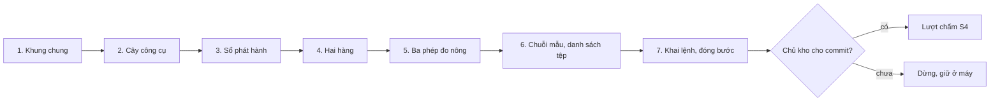

# Kế hoạch: lên đời công cụ design-assembly lên bản 0.7.1

> **Cho tác tử thực thi:** dùng superpowers:executing-plans, làm từng việc theo thứ tự, đánh dấu `- [ ]`.

**Mục tiêu:** viết các phép đo của hồ sơ `_acceptance/upgrade-design-assembly-0-7-1/`, mỗi phép đo có cặp xanh/đỏ, để
lượt chấm S4 chạy đủ 18 eval.

**Cách làm:** thay đổi sản phẩm đã nằm ở commit `8d64f79c`. Kế hoạch chỉ thêm phép đo ở `rang/` của hồ sơ, khai lệnh
của chúng trong `_acceptance/config.yaml`, đổi lệnh e2e theo Hỏi-3, rồi đóng bước viết mã. Khung lấy từ
`_acceptance/upgrade-design-assembly-0-7-0/rang/`. Chép rồi sửa, không import chéo từ hồ sơ cũ, vì hồ sơ đã ký thì không
được đổi.

**Công nghệ:** Node 24 (ESM, `node:test`), Python 3 với PyYAML cho phép đo đọc YAML, git, `make`.

**Spec:** `docs/superpowers/specs/2026-11-18-upgrade-design-assembly-0-7-1-design.md`. Hợp đồng và eval:
`_acceptance/upgrade-design-assembly-0-7-1/contract.md`, `evals.yaml`. Thông điệp ghim của từng phép đo là chữ trong
trường `expected` của eval, chép đúng từng chữ.

## Ràng buộc chung

- Không sửa gì dưới `tools/`, `mk/`, `.github/workflows/`, `governance/`, và không sửa hồ sơ đã ký nào.
- Không sửa `/Users/manh-macmini/design-assembly`. Phép đo chỉ đọc kho ấy bằng `git show ba3af6b:<tệp>`, đường dẫn lấy
  từ `DESIGN_ASSEMBLY_REPO`, mặc định `~/design-assembly`.
- Mã ghim:
  - BASE: `8925e8fffc776534c5388ced3fea36ac2a1345f6`.
  - UPGRADE: `8d64f79c`, viết đủ 40 ký tự vào `matrix.mjs`.
  - OLD_MAIN: `ea774a0f`, viết đủ 40 ký tự.
  - Plugin: `ba3af6b090bb4a0922ff16f708220e9ff0bc57e6`.
  - Cây công cụ: `2da4cc56de55b9805b50baf46731151f12428f63`, 34 tệp.
  - Bước cổng `mk/design-assembly.mk`: `d67aeb30023e8ce4e0583979387c8078653ff3a3`.
- Số ghim:
  - Ở HEAD: 19 quyết định, 27 phép kiểm, 2460 bài đạt, 2 bỏ qua, 294 linh kiện.
  - Ở BASE: 17 quyết định, 25 phép kiểm.
- Thư mục tạm mở bằng `mkdtemp` với tiền tố `upgrade-0-7-1-` và luôn xoá trong `finally`.
- Bản sao nông:
  - Mỗi ca một bản sao mới.
  - `origin` là kho trung gian có `main` ghim. Không bao giờ dùng `main` trên máy làm gốc so.
  - `node_modules` là bản sao APFS (`cp -c -R`). Không cài gì.
- Mỗi phép đo in đúng một dòng xanh và thoát 0. Đỏ thì in mỗi lỗi một dòng, mở đầu bằng tiền tố của phép đo, và thoát 1.
- Mã, chú thích và thông điệp viết tiếng Anh, như hồ sơ 0.7.0.
- Commit: mọi thứ gom vào một commit ở cuối việc 7, và chỉ commit khi chủ kho trả lời có.

## Chỗ cần soi kỹ

1. **Kho plugin vắng.** `release-ledger` và `rows-mirror` phải đỏ với `cannot read`, không được văng lỗi. Việc 3 và việc
   4 có ca đo này.
2. **Thư mục tạm còn sót khi phép đo đỏ giữa chừng.** Mỗi bản sao nông chiếm vài trăm MB. Việc 5 kiểm thư mục tạm không
   còn sau một ca đỏ.
3. **`node_modules` vắng ở worktree.** Phép đo nông phải đỏ với `cp -c node_modules: …`, không được báo nhầm là
   `make check` đỏ. Việc 5 có ca đo này.
4. **Ghim lại sau khi gộp.** HEAD khi ấy nằm trên `main`, hậu duệ của BASE. Chỗ rời nhánh của bản sao vẫn là BASE, và
   `change-list` in dòng «already in origin/main». Việc 6 có ca `--merged`.
5. **Chạy riêng hay trong `make check`.** Bên trong `make check`, `legacy.py` lấy hết lịch sử trước khi cổng chạy. Vì thế
   ca «fetched» chỉ đo bằng `make design-assembly`. Việc 5 ghim điều này: `shallow-alone` không bao giờ gọi
   `make check`.

## Bảng cho người duyệt

| Người dùng thấy gì khác                                   | Đụng đâu                                        | Phục vụ tiêu chí                    |
| --------------------------------------------------------- | ----------------------------------------------- | ----------------------------------- |
| Bản sao nông như CI chạy trọn bộ kiểm và xanh             | `rang/shallow-check.mjs`                        | AC-2 (make check trên bản sao nông) |
| Hai hàng tự lấy nhánh chính khi cổng chạy riêng           | `rang/shallow-alone.mjs`                        | AC-3 (lời «fetched» của hai hàng)   |
| Trang mẫu mới và thẻ lạ bị chặn trên bản sao nông         | `rang/shallow-bite.mjs`                         | AC-4 (hai hàng cắn được)            |
| Kho chạy đúng bản công cụ 0.7.1 mà plugin phát hành       | `rang/tool-tree.mjs`, `rang/release-ledger.mjs` | AC-5 (đúng bản 0.7.1)               |
| Hai hàng giống hệt hàng của plugin, ngoài ra sổ không đổi | `rang/rows-mirror.py`                           | AC-6 (hai hàng chép đúng)           |
| Bài kiểm sổ quyết định không còn chuỗi bị đọc nhầm là thẻ | `rang/fixture-tags.mjs`                         | AC-7 (chuỗi mẫu sạch thẻ)           |
| Nhánh không đổi gì ngoài commit lên đời và hồ sơ          | `rang/change-list.mjs`                          | AC-8 (danh sách tệp)                |
| Lượt chấm chạy e2e đúng chế độ không cơ sở dữ liệu như CI | `_acceptance/config.yaml`                       | Hỏi-3 (lệnh e2e)                    |
| Hồ sơ đóng bước viết mã, nhật ký wiki có một dòng         | `contract.md`, `wiki/log.md`                    | AC-8 (tệp của hồ sơ)                |

Thứ tự việc: bảy việc nối tiếp trên cùng nhánh, không việc nào chạy song song (`independent: false` cho cả bảy), vì
việc 2 đến việc 6 cùng thêm bài vào hai tệp cặp và cùng sửa `_acceptance/config.yaml`.

---

### Việc 1: Khung chung `lib.mjs` và `matrix.mjs`

**Tệp:**

- Tạo `_acceptance/upgrade-design-assembly-0-7-1/rang/lib.mjs`. Chép `lib.mjs` của hồ sơ 0.7.0, đổi tiền tố tạm thành
  `upgrade-0-7-1-`, thêm hàm `shallowClone`.
- Tạo `_acceptance/upgrade-design-assembly-0-7-1/rang/matrix.mjs`.

**Giao diện:**

- Cung cấp, giữ nguyên như 0.7.0: `HERE`, `ROOT`, `PLUGIN_REPO`, `option`, `git`, `lines`, `blobId`, `treeId`,
  `scratch`, `linkedCopy`, `sharedClone`.
- Cung cấp mới:
  `shallowClone(root: string, rev: string, { mainAt: string }): { dir: string, kho: string, remove(): void }`.
  1. Kho trung gian `dir/mid` là kho trần, có `objects/info/alternates` trỏ vào thư mục đối tượng của
     `git rev-parse --git-common-dir`.
  2. Kho trung gian có `refs/heads/main = mainAt` và `refs/heads/tip = rev`.
  3. `dir/kho` lấy `tip` với `--depth 1`, checkout `FETCH_HEAD`, rồi thêm remote `origin` trỏ `file://<mid>`.
  4. Sao `node_modules` bằng `cp -c -R`. Lỗi ở bước này thì ném `cp -c node_modules: <stderr>`.
- Cung cấp thêm `leftMain(kho: string): string | null`: `git merge-base HEAD origin/main`, trả `null` khi không tính
  được.
- `matrix.mjs` cung cấp:
  - `BASE`, `UPGRADE`, `OLD_MAIN`;
  - `RELEASE = { version: "0.7.1", tool, files: 34 }`;
  - `PLUGIN_SOURCE = { commit, ledger: "plugins/design-assembly/references/releases.json" }`;
  - `GATE_STEP`, `TOOL_FOLDER`, `STAMP`;
  - `GATE = { decisions: 19, checks: 27 }`, `BASE_GATE = { decisions: 17, checks: 25 }`;
  - `TESTS = { passed: 2460, skipped: 2 }`, `COMPONENTS = 294`;
  - `FETCHED(row)`: trả dòng «`<row>, debt: a shallow checkout: main and the history back to where this branch left it
were fetched from origin`»;
  - `ROWS = ["decision-sheet", "owner-calls"]`;
  - `UPGRADE_CHANGES`: 6 tệp của commit;
  - `BRANCH_MAY_CHANGE`: danh sách tệp ngoài commit ở dòng «Tệp được đổi ngoài commit» trong phần đầu `evals.yaml`.

- [ ] **Bước 1:** chạy thử `shallowClone(ROOT, "HEAD", { mainAt: BASE })` bằng `node -e`.
  - Kỳ vọng: `git -C kho rev-parse --is-shallow-repository` in `true`.
  - Kỳ vọng: sau `git -C kho fetch -q origin main`, `git -C kho rev-parse origin/main` in BASE.
  - Kỳ vọng: sau `remove()`, thư mục tạm không còn.
- [ ] **Bước 2:** chạy thử như bước 1 với `mainAt: OLD_MAIN`. Kỳ vọng: `origin/main` là OLD_MAIN.

### Việc 2: `tool-tree.mjs` và tệp cặp `measures-two-way.mjs` (E8, E15)

**Tệp:** tạo `rang/tool-tree.mjs`, tạo `rang/measures-two-way.mjs`. Trong `_acceptance/config.yaml`, thêm
`da071_tool_tree` và `da071_two_way: "node --test _acceptance/upgrade-design-assembly-0-7-1/rang/measures-two-way.mjs"`.

**Giao diện:**

- Lệnh: `node tool-tree.mjs [--root <kho>]`. Lấy `tool-tree.mjs` của 0.7.0, thay số ghim.
- Dòng xanh: chữ của E8.
- `measures-two-way.mjs` chép khung `run`, `green`, `red`, `redOnCopy` của 0.7.0. Các việc 3, 4, 5 và 6 thêm bài vào tệp
  này.

- [ ] **Bước 1:** viết bài `tool-tree: green as it is; red on a changed tool file, a 0.7.0 stamp, a changed gate step`
      với ba ca đỏ của E15.
  - Một tệp công cụ đổi một byte: `differs from the plugin's version 0.7.1`.
  - Dấu ghi `0.7.0`: `the stamp says version 0.7.0, not 0.7.1`.
  - Bước cổng khác mẫu: `is not the plugin's gate step`.
- [ ] **Bước 2:** chạy `node --test …/rang/measures-two-way.mjs`. Kỳ vọng: đỏ, vì chưa có tệp đo.
- [ ] **Bước 3:** viết `tool-tree.mjs`.
- [ ] **Bước 4:** chạy lại `node --test …/rang/measures-two-way.mjs`. Kỳ vọng: 1 bài đạt. Chạy `node …/rang/tool-tree.mjs`
      in dòng của E8.

### Việc 3: `release-ledger.mjs` (E9, E15)

**Tệp:** tạo `rang/release-ledger.mjs`. Thêm `da071_release_ledger` vào `config.yaml`.

**Giao diện:**

- Lệnh: `node release-ledger.mjs [--plugin-repo <dir>] [--ledger <tệp>]`.
- Lấy bản 0.7.0, thay `RELEASE` và `PLUGIN_SOURCE`.
- Dòng xanh: chữ của E9.

- [ ] **Bước 1:** thêm bài `release-ledger: green at the pinned commit; red with no repository, no such version`.
  - Không có kho plugin: `cannot read`.
  - `--ledger` bỏ mục 0.7.1: `no version 0.7.1 at ba3af6b`.
- [ ] **Bước 2:** chạy hai bài. Kỳ vọng: bài mới đỏ.
- [ ] **Bước 3:** viết `release-ledger.mjs`.
- [ ] **Bước 4:** chạy lại hai bài. Kỳ vọng: cả hai đạt.

### Việc 4: `rows-mirror.py` (E10, E16)

**Tệp:** tạo `rang/rows-mirror.py`. Thêm `da071_rows_mirror: "python3 _acceptance/upgrade-design-assembly-0-7-1/rang/rows-mirror.py"`
vào `config.yaml`.

**Giao diện:**

- Lệnh: `python3 rows-mirror.py [--root <kho>] [--plugin-repo <dir>]`.
- Đọc bằng `yaml.safe_load`:
  - `design/decisions.yaml` và `design/theme.json` ở `--root`;
  - cùng hai tệp ấy ở BASE, qua `git -C <root> show <BASE>:<tệp>`;
  - cùng hai tệp ấy ở plugin, qua `git -C <plugin> show ba3af6b:<tệp>`.
- Kiểm:
  1. Mỗi hàng trong `ROWS` bằng hàng của plugin, từng trường một.
  2. Mỗi `checks[<row>]` bằng của plugin, sau khi bỏ khoá `blueprint` trong từng mục.
  3. Bỏ hai hàng và hai mục `checks` ra thì cả hai tệp bằng bản BASE.
- Dòng xanh: chữ của E10.

- [ ] **Bước 1:** thêm bài `rows-mirror: green as it is; red on a changed field, a lost row, a changed check, another
changed row, no plugin` với bốn ca đỏ của E16 và ca thứ năm.
  - Ca thứ năm, không có kho plugin: `cannot read`.
  - Ca «một hàng khác đổi»: sửa `note` của hàng `ledger-shapes`. Kỳ vọng dòng
    `design/decisions.yaml changed beyond the two rows since 8925e8ff`.
- [ ] **Bước 2:** chạy bài. Kỳ vọng: đỏ.
- [ ] **Bước 3:** viết `rows-mirror.py`.
- [ ] **Bước 4:** chạy lại bài. Kỳ vọng: đạt. `python3 …/rows-mirror.py` in dòng của E10.

### Việc 5: Ba phép đo trên bản sao nông và tệp cặp `shallow-two-way.mjs` (E2–E7)

**Tệp:**

- Tạo `rang/shallow-check.mjs`, `rang/shallow-alone.mjs`, `rang/shallow-bite.mjs`, `rang/shallow-two-way.mjs`.
- Thêm vào `config.yaml`: `da071_shallow_check`, `da071_shallow_alone`, `da071_shallow_bite`, và
  `da071_shallow_two_way: "node --test _acceptance/upgrade-design-assembly-0-7-1/rang/shallow-two-way.mjs"`.

**Giao diện:**

- Cả ba dùng `shallowClone(ROOT, rev, { mainAt })` và `leftMain`. Mặc định `--rev HEAD --main-at BASE`.
- **`shallow-check.mjs [--rev] [--main-at] [--components <n>]`**
  - Chạy `make check`.
  - `MUST_SAY` gồm dòng cổng (lấy từ `GATE`) và
    `component manifest: design/component-registry.json is up to date (<n> components)`, `<n>` mặc định `COMPONENTS`.
  - Đếm số bài đạt và kiểm `leftMain === BASE`.
  - Dòng xanh: chữ của E2.
- **`shallow-alone.mjs [--rev] [--main-at] [--owner-calls-from <commit>]`**
  - Chạy `make design-assembly`, không bao giờ `make check`.
  - Kiểm `FETCHED("decision-sheet")` và `FETCHED("owner-calls")`, rồi kiểm `leftMain`.
  - `--owner-calls-from` thay `tools/design-assembly/owner-calls.mjs` của bản sao bằng bản ở commit đó, trước khi chạy.
  - Dòng đỏ có:
    - `alone: decision-sheet did not say main was fetched from origin`;
    - `alone: make design-assembly exit <mã>`;
    - `alone: the clone left main at <8 ký tự>, not 8925e8ff`.
  - In thêm mọi dòng của đầu ra `make` có chữ `no main branch to compare with`. E5 ghim hai dòng ấy, cho
    `decision-sheet` và `owner-calls`.
  - Dòng xanh: chữ của E4.
- **`shallow-bite.mjs [--rev] [--main-at] [--omit-checks]`**
  - Dựng bốn bản sao mới. Mỗi thay đổi commit trong bản sao bằng `git -c user.name=rang -c user.email=rang@example.invalid commit`,
    để nó thuộc phần nhánh thêm.
  - Bốn ca:
    1. Không đổi gì: `make design-assembly` thoát 0.
    2. Thêm `design/patterns/trang-moi.md`: đầu ra có
       `pattern:trang-moi: a new kind of screen (trang-moi) is the owner's call`.
    3. Thêm `tests/the-thu.test.ts` mang thẻ `decision:khong-co-hang`: đầu ra có
       `decision:khong-co-hang: tests/the-thu.test.ts proves it, and the ledger has no row for it`.
    4. Thay `tests/design-check.test.ts` bằng bản BASE: đầu ra gọi tên `decision:a`, `decision:other`, `decision:a-b`.
  - `--omit-checks` bỏ hai mục `checks` của `ROWS` khỏi `design/theme.json` trong mỗi bản sao, rồi commit cùng thay đổi.
  - Dòng đỏ: `bite: a new page under design/patterns did not stop owner-calls`,
    `bite: an untold tag did not stop decision-sheet`.
  - Dòng xanh: chữ của E6.

- [ ] **Bước 1:** viết `shallow-two-way.mjs` với ba bài.
  - **`shallow-check: red on 8925e8ff`:** một lần chạy `--rev BASE --components 295`. Kỳ vọng hai dòng đỏ của E3:
    `did not say: design-assembly: 19 decisions…` và `did not say: component manifest: … (295 components)`.
  - **`shallow-alone`:** hai ca.
    - `red with the 0.7.0 owner-calls`, chạy `--owner-calls-from BASE`.
    - `red when origin main is older`, chạy `--main-at OLD_MAIN`.
    - Kỳ vọng: các dòng của E5.
  - **`shallow-bite: red without the two checks`:** chạy `--omit-checks`. Kỳ vọng: các dòng của E7.
  - Mỗi bài kiểm thêm: sau khi chạy, không còn thư mục `upgrade-0-7-1-*` mới trong `os.tmpdir()`.
- [ ] **Bước 2:** chạy `node --test …/shallow-two-way.mjs`. Kỳ vọng: đỏ, vì chưa có tệp đo.
- [ ] **Bước 3:** viết `shallow-check.mjs` từ bản 0.7.0. Thay `sharedClone` và remote thật bằng `shallowClone`, bỏ phần
      tệp máy sinh vì nó thuộc AC của 0.7.0.
- [ ] **Bước 4:** viết `shallow-alone.mjs` và `shallow-bite.mjs`.
- [ ] **Bước 5:** chạy ba lệnh xanh và tệp cặp, chạy nền vì mất nhiều phút.
  - `node …/shallow-check.mjs` in dòng của E2.
  - `node …/shallow-alone.mjs` in dòng của E4.
  - `node …/shallow-bite.mjs` in dòng của E6.
  - `node --test …/shallow-two-way.mjs`: 3 bài đạt.
- [ ] **Bước 6:** ca `node_modules` vắng. Chạy `shallow-alone.mjs` với `--root` là một bản sao liên kết thiếu
      `node_modules`. Kỳ vọng: đỏ với `cp -c node_modules:`. Ghi kết quả vào ghi chú bước này; không thêm bài vào tệp cặp.

### Việc 6: `fixture-tags.mjs` và `change-list.mjs` (E12, E13, E17, E18)

**Tệp:** tạo `rang/fixture-tags.mjs`, `rang/change-list.mjs`. Thêm `da071_fixture_tags` và `da071_change_list` vào
`config.yaml`.

**Giao diện:**

- **`fixture-tags.mjs [--root] [--file-from <commit>]`**
  - `import { taggedTests } from "<root>/tools/design-assembly/owner-calls.mjs"`.
  - Chép `tests/design-check.test.ts` (bản ở `--root`, hoặc bản ở `--file-from` qua `git show`) vào
    `scratch/tests/design-check.test.ts`.
  - Gọi `taggedTests(scratch, "tests")`.
  - Rỗng thì ra dòng xanh của E12. Có thẻ thì đỏ với
    `fixtures: tests/design-check.test.ts still holds tags: <id cách bởi dấu cách, theo thứ tự đọc, có tiền tố decision:>`.
  - Dòng xanh còn phải nêu ba thẻ của BASE, nên phép đo đọc bản BASE ngay trong lượt xanh.
- **`change-list.mjs [--root] [--commit-changes <tệp>] [--branch-changes <tệp>] [--merged]`**
  - Lấy bản 0.7.0, bỏ `--groups`. Danh sách tệp của commit là `UPGRADE_CHANGES`, so trọn danh sách, không theo nhóm.
  - `BRANCH_MAY_CHANGE` có tiền tố thư mục hồ sơ.

- [ ] **Bước 1:** thêm bài
      `fixture-tags: green as it is; red on the fixtures of 8925e8ff` (E17). Chạy `--file-from BASE`.
- [ ] **Bước 2:** thêm bài `change-list: green as it is; red on an extra commit file, a lost one, a branch file beyond,
a wiki file beyond; green merged`. Bốn ca đỏ theo E18, ca `--merged` xanh.
- [ ] **Bước 3:** chạy hai bài. Kỳ vọng: đỏ.
- [ ] **Bước 4:** viết `fixture-tags.mjs` và `change-list.mjs`.
- [ ] **Bước 5:** chạy `node --test …/measures-two-way.mjs`. Kỳ vọng: 5 bài đạt (tool-tree, release-ledger, rows-mirror, fixture-tags, change-list).

### Việc 7: Khai lệnh còn lại, đóng bước viết mã

**Tệp:**

- Sửa `_acceptance/config.yaml`:
  - thêm `executors.test.da071_two_tests: "npx vitest run tests/ci-ban-sao-nong.test.ts tests/design-check.test.ts --coverage.enabled=false --reporter=verbose"`;
  - đổi `executors.script.e2e` thành `"DATABASE_URL= make e2e"` (Hỏi-3), giữ chú thích và thêm «Hỏi-3 của
    upgrade-design-assembly-0-7-1».
- Sửa `wiki/log.md`: thêm một dòng, đúng khuôn dòng cuối của tệp.
- Sửa `_acceptance/upgrade-design-assembly-0-7-1/contract.md`: `status: implemented`.

- [ ] **Bước 1:** chạy lệnh của `da071_two_tests`. Kỳ vọng: thoát 0, không bài nào bỏ qua (E11).
- [ ] **Bước 2:** chạy `DATABASE_URL= npx playwright test tests/e2e/account.spec.ts -g "login-loi-may-chu"`. Kỳ vọng: 4/4
      đạt, xác nhận lệnh mới của Hỏi-3.
- [ ] **Bước 3:** chạy `make check`. Kỳ vọng: thoát 0, đầu ra có dòng 19/27 (E1).
- [ ] **Bước 4:** chạy `node …/change-list.mjs`. Kỳ vọng: xanh, vì mọi tệp mới nằm trong danh sách được phép.
- [ ] **Bước 5:** đặt `status: implemented`.
- [ ] **Bước 6:** hỏi chủ kho, có câu trả lời có thì commit `test(upgrade-design-assembly-0-7-1): measures and their
two-way pairs` cùng dòng `Co-Authored-By`.

## Sau kế hoạch

- Lượt chấm S4 chạy workflow `acceptance-verify.js` của kit.
  - Args sinh bằng `s4-args.mjs --diff-base origin/main`.
  - Bản chép workflow đặt trong `dist/`.
- Gặp lỗi trong `tools/design-assembly/`: vòng dừng, trình chủ kho, và báo phiên giao việc như một lỗi của plugin.
